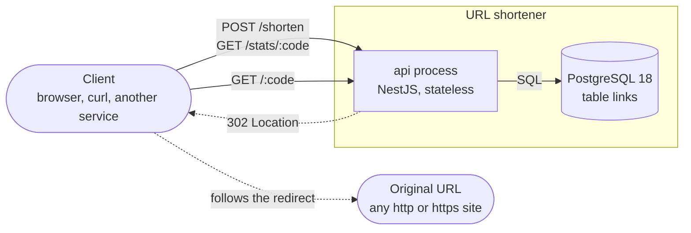
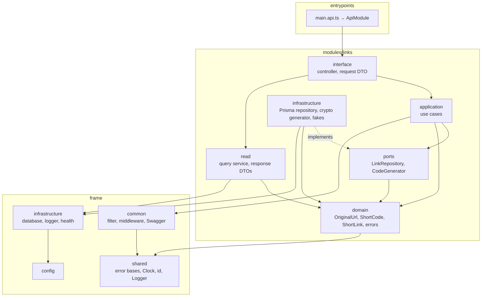
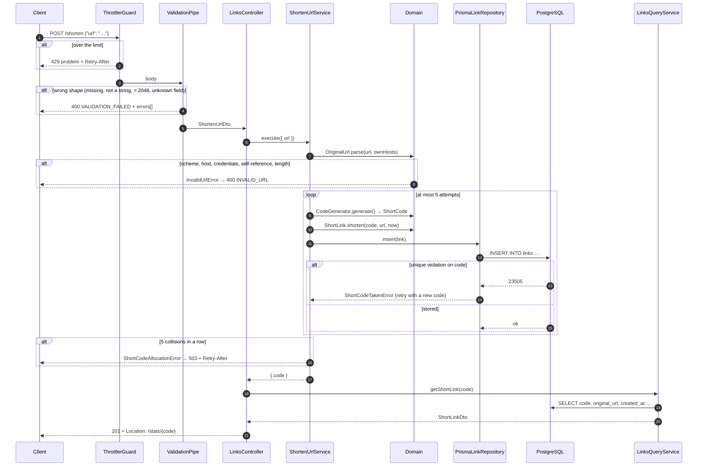
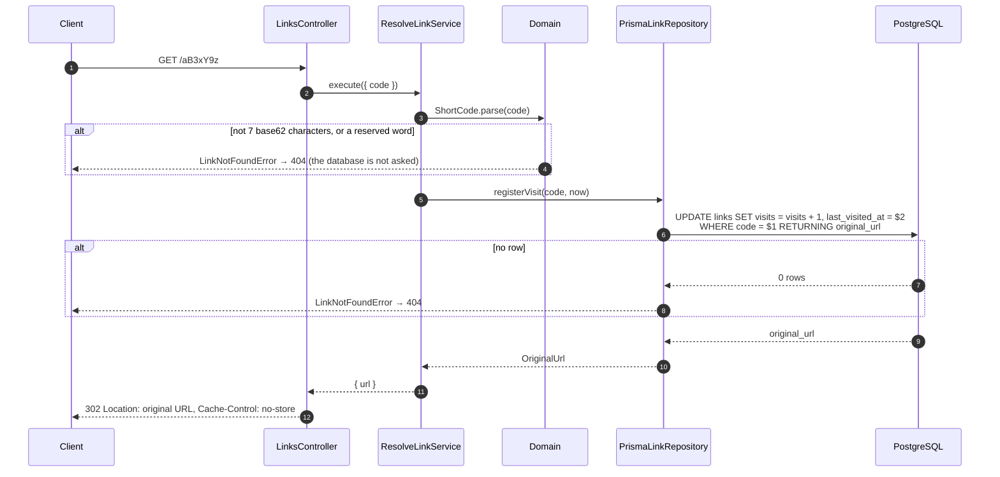
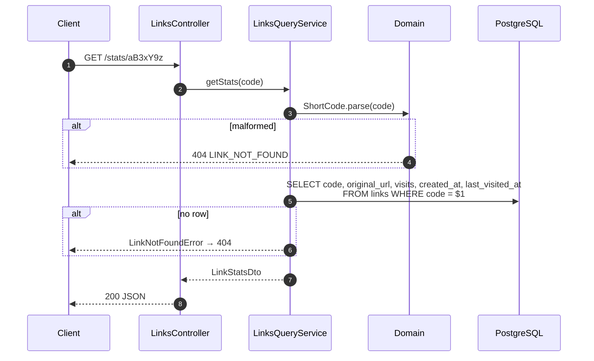
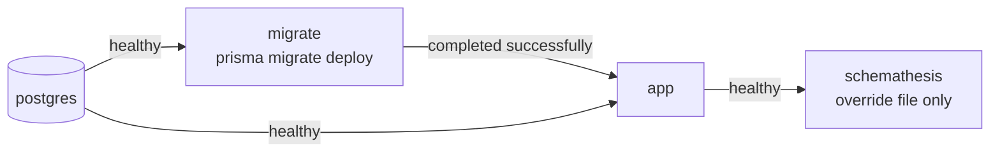
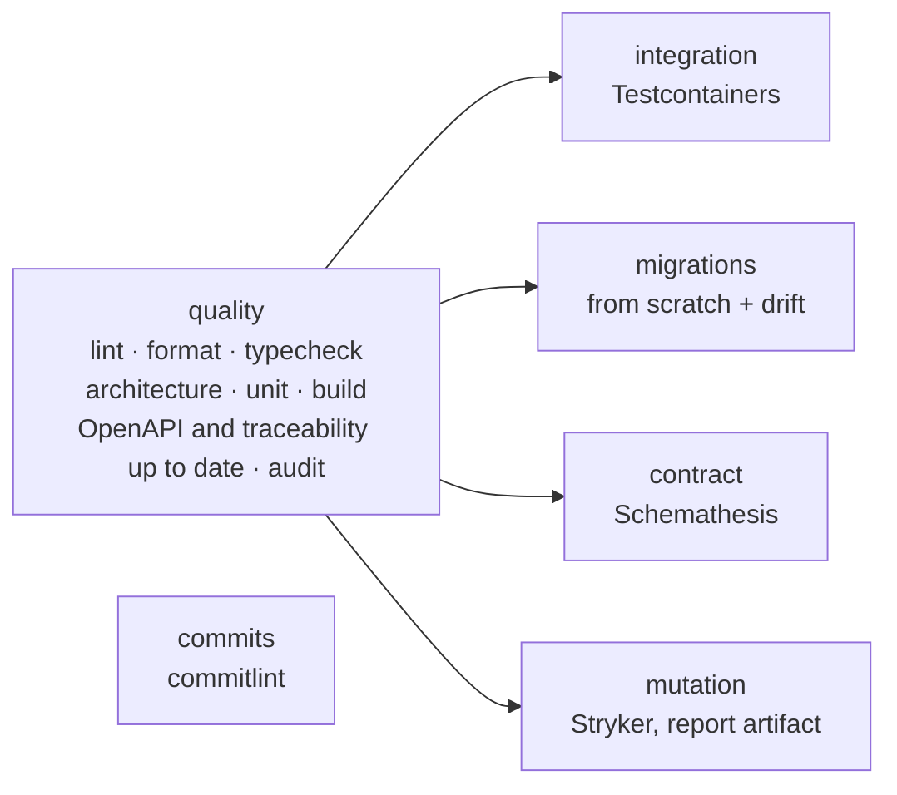

# Architecture

The service end to end: what it is, how a request travels through it, how data is stored, how
it fails, how it is operated, tested and delivered. Decisions and their alternatives live in
[`adr/`](adr); this document describes the result.

## 1. Context and boundaries



- **Inside**: one stateless `api` process and one PostgreSQL database with one table.
- **Outside**: the client, and the sites that links point to. The service never fetches a
  destination URL — it only stores it and names it in a `Location` header — so it makes no
  outbound requests at all (and has no SSRF surface).
- **Not in the system, on purpose**: users and authentication, a cache, a queue, a worker
  process, metrics and tracing. Why, and what would bring each in:
  [ADR 0003](adr/0003-architecture.md), [`scaling.md`](scaling.md).

## 2. Layers and modules

The structure follows a set of shared NestJS conventions: one business concept is one
module; the domain level is chosen per module; transport is wired separately from the core.
There is one business module, `links`, built as **layered · level 4 · CQS**: a
framework-free domain, use cases that depend on ports, adapters in infrastructure, and a
separate read path.

```
src/
  entrypoints/      bootstrap.ts, api.module.ts, main.api.ts — one process, imports only
  config/           env schema (zod), typed namespaces; the only place that reads process.env
  common/           the HTTP frame: exception filter, problem DTO, middleware, Swagger helpers
  shared/           framework-free: error bases, Clock, uuid v7, Logger interface
  infrastructure/   technical modules: database (Prisma), logger (pino), health; SharedModule
  modules/links/
    domain/         OriginalUrl, ShortCode, ShortLink, errors, reserved words — plain TypeScript
    ports/          LinkRepository, CodeGenerator — interfaces in domain terms
    application/    ShortenUrlService, ResolveLinkService — the write path (use cases)
    infrastructure/ PrismaLinkRepository, CryptoCodeGenerator, and the fakes of both ports
    read/           LinksQueryService + response DTOs — the read path
    interface/      LinksController, request DTO, OpenAPI decorators
    links.module.ts        core: inert until a transport calls it
    links.http.module.ts   transport: declares the controller, the rate limiter
```



What each layer may import is not a matter of discipline:

| Layer              | May import                                                                               | Enforced by                           |
| ------------------ | ---------------------------------------------------------------------------------------- | ------------------------------------- |
| `domain/`          | itself and `shared/` — **no package at all**, not even a Node built-in                   | `eslint-plugin-boundaries` allow-list |
| `ports/`           | `domain/`, `shared/`; no Nest, no Prisma                                                 | boundaries                            |
| `application/`     | `domain/`, `ports/`, `shared/`, `common/`; no Prisma, no `infrastructure/`, no `config/` | boundaries                            |
| `read/`            | `domain/`, global `infrastructure/` (Prisma); never `application/` writes                | boundaries                            |
| `modules/x`        | another module only through its `index.ts`                                               | `no-restricted-imports` + boundaries  |
| core `*.module.ts` | never a controller                                                                       | boundaries; the module-graph test     |

`test/architecture/boundaries.spec.ts` lints one deliberately wrong snippet per rule and
asserts the exact rule that fires — a green `pnpm lint` alone cannot tell "no violations" from
"the rule stopped working". `process-graph.spec.ts` walks the Nest module metadata and checks
where classes are actually registered.

Deviations from the shared conventions (no `Actor`, a repository port, no worker, …) are
listed with their reasons in [ADR 0003](adr/0003-architecture.md).

## 3. Request flows

Every request first passes the same pipeline (`entrypoints/bootstrap.ts`), in this order:

1. `helmet` — security headers.
2. correlation middleware — takes `x-correlation-id` or generates a UUID v7, opens the request
   context (AsyncLocalStorage), sets the id and `Cache-Control: no-store` on the response.
3. request logger — one line when the response finishes.
4. JSON body parser, 10 kB limit; a parse failure becomes `400 MALFORMED_JSON`.
5. Nest routing → global `ValidationPipe` (shape of the body) → controller.
6. Anything thrown anywhere → `AppExceptionFilter` → `application/problem+json`.

### `POST /shorten`



The use case never asks "is this code free?" before inserting. The unique index is the only
arbiter, so two concurrent requests cannot both take the same code
([ADR 0004](adr/0004-short-code-generation.md)).

### `GET /:code`



One statement finds the link, counts the visit and returns the destination. There is no
moment between reading the counter and writing it for another request to slip into
([ADR 0006](adr/0006-atomic-visit-counter.md)).

### `GET /stats/:code`



The read path goes straight to the ORM with an explicit `select` and returns a DTO; it loads
no domain object and writes nothing.

### Routing at the root

`GET /:code` shares the root with service routes. They cannot collide:

- `/health/*`, `/stats/*`, `/docs`, `/docs-json` are registered before the catch-all, and a
  code is exactly 7 base62 characters — `docs-json` has a dash, `health` has 6 letters.
- The only service words that _are_ 7 base62 characters are `shorten` and `metrics`. Both
  are reserved: never generated, and rejected by `ShortCode.parse` in any letter case.
- `/shorten` is claimed by an `@All('shorten')` handler declared before `/:code`, which answers
  `405` + `Allow: POST` for every method but `POST`. Each path has such a fallback, so a known
  path with the wrong method is a `405`, never a misleading `404`.

## 4. Data model

One table, owned by the `links` module (`prisma/schema.prisma`, migration
`20261001135710_add_links`).

| Column            | Type                  | Notes                                                                                                   |
| ----------------- | --------------------- | ------------------------------------------------------------------------------------------------------- |
| `id`              | `uuid` PK             | UUID v7, generated by the application; never exposed                                                    |
| `code`            | `text` `UNIQUE`       | the public identifier; `CHECK (code ~ '^[0-9A-Za-z]{7}$')`                                              |
| `original_url`    | `text`                | normalised; `CHECK (char_length BETWEEN 1 AND 2048)`                                                    |
| `visits`          | `bigint` default `0`  | `CHECK (visits >= 0)`; `bigint` because a counter outgrows `int4` and `int → bigint` is a table rewrite |
| `created_at`      | `timestamptz(3)`      | set by the application clock                                                                            |
| `updated_at`      | `timestamptz(3)`      |                                                                                                         |
| `last_visited_at` | `timestamptz(3)` null | `null` until the first visit                                                                            |

Indexes: `links_pkey (id)` and `links_code_key UNIQUE (code)` — nothing else, because there
is nothing else to query by. The unique index does double duty: it serves every lookup, and
it is what makes a code collision detectable.

The `CHECK` constraints are hand-written in the migration (Prisma cannot express them). The
domain validates first, the database validates last; `test/links/link-repository.int-spec.ts`
proves the database refuses bad rows on its own.

**Why an `id` when `code` is unique?** The primary key is an implementation detail that never
changes; the code is a public attribute. If codes ever need to be re-issued, lengthened or
made customisable, nothing references them by key. UUID v7 is time-ordered, so the primary
key index grows at its right edge instead of splitting pages at random.

### The lookup, measured

With 1 000 000 rows (table 104 MB, `links_code_key` 21 MB, `links_pkey` 38 MB):

```
EXPLAIN (ANALYZE, BUFFERS)
SELECT code, original_url, visits, created_at, last_visited_at FROM links WHERE code = '0500000';

 Index Scan using links_code_key on links (actual rows=1.00 loops=1)
   Index Cond: (code = '0500000'::text)
   Buffers: shared hit=4
```

```
EXPLAIN (ANALYZE, BUFFERS)
UPDATE links SET visits = visits + 1, last_visited_at = now(), updated_at = now()
WHERE code = '0500000' RETURNING original_url;

 Update on links (actual rows=1.00 loops=1)
   Buffers: shared hit=16
   ->  Index Scan using links_code_key on links (actual rows=1.00 loops=1)
         Index Cond: (code = '0500000'::text)
         Buffers: shared hit=4
```

Four buffers to find a row among a million — three B-tree levels and the heap page. The
redirect costs 16 buffers in total: the lookup plus writing the new row version and updating
both indexes. `test/links/migrations.int-spec.ts` asserts the plan is an index scan, so a
dropped or changed index fails a test rather than a latency graph.

The cost of counting in the row is that every visit writes a new row version. For this
service that is the right trade — the counts are exact and there is nothing to operate — and
[`scaling.md`](scaling.md) says when it stops being right.

## 5. Errors

Three hierarchies, one filter, one format ([ADR 0009](adr/0009-error-format-rfc9457.md)).

| Thrown by                 | Class                                                         | Status              | `code`                           |
| ------------------------- | ------------------------------------------------------------- | ------------------- | -------------------------------- |
| `ValidationPipe`          | `ValidationFailedException`                                   | 400                 | `VALIDATION_FAILED` + `errors[]` |
| body parser               | `MalformedJsonException`                                      | 400                 | `MALFORMED_JSON`                 |
| domain                    | `InvalidUrlError` (`DomainError`)                             | 400                 | `INVALID_URL`                    |
| domain, repository, query | `LinkNotFoundError` (`NotFoundError`)                         | 404                 | `LINK_NOT_FOUND`                 |
| Nest router               | unknown route                                                 | 404                 | `NOT_FOUND`                      |
| controller fallback       | `MethodNotAllowedProblem`                                     | 405 + `Allow`       | `METHOD_NOT_ALLOWED`             |
| body parser               | body over 10 kB                                               | 413                 | `PAYLOAD_TOO_LARGE`              |
| body parser               | undecodable charset                                           | 415                 | `UNSUPPORTED_MEDIA_TYPE`         |
| throttler                 | over the limit                                                | 429 + `Retry-After` | `RATE_LIMITED`                   |
| use case                  | `ShortCodeAllocationError` (`InfrastructureError`, retryable) | 503 + `Retry-After` | `SHORT_CODE_ALLOCATION_FAILED`   |
| readiness                 | database down / shutting down                                 | 503                 | `SERVICE_UNAVAILABLE`            |
| anything else             | —                                                             | 500                 | `INTERNAL`                       |

```json
{
  "type": "about:blank",
  "title": "Bad Request",
  "status": 400,
  "detail": "URL scheme must be http or https",
  "instance": "/shorten",
  "code": "INVALID_URL",
  "correlationId": "01a0f7eb-7f13-71f2-99f1-a6096e67b233"
}
```

- Modules throw classes that extend bases in `shared/errors`; they never know HTTP. The filter
  maps **by base class**, so adding an error never touches the filter.
- The client branches on `code`, which is stable; `detail` is for people.
- An unknown error is a `500` with a fixed `detail`. Its message, type and stack go to the
  log under the same `correlationId`, never to the response. The same holds for framework
  5xx exceptions.
- `ShortCodeTakenError` (a `ConflictError`) never reaches a client: the use case reacts to
  it by drawing another code.

## 6. Operations

**Configuration** (`src/config`). The environment is parsed once at boot by a zod schema; an
invalid value stops the process with every failing key listed. Secrets and URLs have no
defaults; only safe values do. Code reads typed namespaces (`appConfig`, `databaseConfig`, …),
never `process.env`. A test asserts that `.env.example` and `.env.test` declare exactly the
schema's keys.

| Variable                   | Default | Meaning                                                      |
| -------------------------- | ------- | ------------------------------------------------------------ |
| `NODE_ENV`                 | —       | `development` / `test` / `production`                        |
| `PORT`                     | `3000`  | HTTP port                                                    |
| `PUBLIC_BASE_URL`          | —       | origin used in `shortUrl`; links to its host are rejected    |
| `DATABASE_URL`             | —       | `postgresql://…`                                             |
| `DATABASE_POOL_SIZE`       | `10`    | connections per instance                                     |
| `LOG_LEVEL`                | `info`  | `debug` / `info` / `warn` / `error`                          |
| `LOG_PRETTY`               | `false` | human-readable logs for development                          |
| `SHORTEN_RATE_LIMIT`       | `30`    | `POST /shorten` requests per window per client IP            |
| `SHORTEN_RATE_TTL_SECONDS` | `60`    | the window                                                   |
| `TRUST_PROXY_HOPS`         | `0`     | reverse proxies in front (so the limiter sees the client IP) |
| `SHUTDOWN_TIMEOUT_MS`      | `10000` | drain deadline                                               |

**Logging.** JSON lines on stdout through pino, behind a `Logger` interface in `shared/`.
Every line carries the request's `correlationId`, taken from the request context — application
code never passes it. One line per request (`method`, route _pattern_, `status`,
`durationMs`), one per use case (`useCase`, `durationMs`, `outcome`), 4xx at `warn`, 5xx at
`error` with the error under `err`. `authorization`, `cookie`, `password`, `token`, `secret`
and `apiKey` are redacted at any of the first four nesting levels. Request bodies and URLs
with ids are never logged.

**Health.** `GET /health/live` answers `200` if the process runs and checks nothing external —
a restart does not fix a dead database. `GET /health/ready` runs `SELECT 1` with a 2 s
timeout and reports `503` when it fails or once shutdown has begun. The container
`HEALTHCHECK` uses liveness; Compose gates dependants on readiness.

**Graceful shutdown.** On `SIGTERM`: readiness turns `503` → the HTTP server stops accepting
connections and closes keep-alive connections as they go idle → in-flight requests finish →
Prisma disconnects → the process exits `0`. If draining exceeds `SHUTDOWN_TIMEOUT_MS` the
process exits `1`; Compose's `stop_grace_period` is longer than that, so `SIGKILL` never
arrives mid-request. `test/health/shutdown.int-spec.ts` starts a slow request, closes the
app, and asserts the request still completes and no database connection remains.

**Security.** `helmet` headers on every response; JSON bodies limited to 10 kB; unknown body
fields rejected; a rate limit on link creation ([ADR 0010](adr/0010-rate-limiting.md));
`Cache-Control: no-store` by default; the container runs as a non-root user; CI audits
production dependencies. CORS is not enabled: there is no browser client to allow.

**Database handles.** Repositories receive `DB_WRITE`, query services `DB_READ`. Both resolve
to the same Prisma client today; a read replica later is a change in one file. Nothing
session-scoped is used (no session `SET`, no session advisory locks), so a transaction-mode
pooler can be added without code changes. `statement_timeout` is 30 s.

## 7. Testing

The full list of requirements and the level that verifies each is in
[`requirements.md`](requirements.md); the reasoning is in
[ADR 0011](adr/0011-testing-strategy.md).

| Level        | Proves                          | Example                                                                                            |
| ------------ | ------------------------------- | -------------------------------------------------------------------------------------------------- |
| unit         | each rule, in isolation         | 30+ table cases of URL validation; collision retries on a scripted generator                       |
| property     | a rule holds for every input    | any string either parses or throws `InvalidUrlError`; shorten → resolve round-trips                |
| architecture | boundaries are enforced         | Prisma imported from `application/` fails lint with the expected rule                              |
| integration  | the database behaves as assumed | 250 parallel visits through two pools → `visits = 250`; 100 parallel inserts of one code → one row |
| API          | the system, end to end          | every status code, header and problem body of every endpoint                                       |
| fuzz         | the OpenAPI schema is true      | ~1 900 generated requests, all Schemathesis checks                                                 |
| mutation     | the tests would notice a bug    | 149 mutants in `domain/` and `application/`, none survive                                          |

Two things make the suite trustworthy rather than merely green. Tests that concern the
database run against a real PostgreSQL — a mocked repository cannot lose an update, so it
cannot prove one is not lost. And the in-memory fake of `LinkRepository` runs through the same
contract tests as the Prisma adapter, so the fast use-case tests cannot drift from reality.

## 8. Build and delivery

**Image** (`Dockerfile`, multi-stage): `deps` installs everything and generates the Prisma
client → `build` compiles → `prod-deps` installs production dependencies only → `runtime`
is `node:24-slim` with `dist/` and production `node_modules`, running as `node` with a
liveness `HEALTHCHECK`. The `migrate` target carries the Prisma CLI and the migrations.

**Compose** ([ADR 0012](adr/0012-docker-compose.md)):



| File                              | Adds                                          | Command                                                                         |
| --------------------------------- | --------------------------------------------- | ------------------------------------------------------------------------------- |
| `docker-compose.yml`              | the stack: database → migrations → api        | `docker compose up --build`                                                     |
| `docker-compose.dev.yml`          | publishes Postgres on the host for `pnpm dev` | `docker compose -f docker-compose.yml -f docker-compose.dev.yml up -d postgres` |
| `docker-compose.schemathesis.yml` | the fuzzer; raises the rate limit of `app`    | `… -f docker-compose.schemathesis.yml run --rm --build schemathesis`            |

Migrations are a separate container that must finish before the app starts — never part of
the app's entrypoint, where replicas starting together would race for the migration lock.

**CI** (`.github/workflows/ci.yml`, [ADR 0013](adr/0013-ci.md)):



`contract` and `mutation` run on pushes to `master` and nightly, not on pull requests.
Dependabot watches npm, Docker, Compose and Actions.
